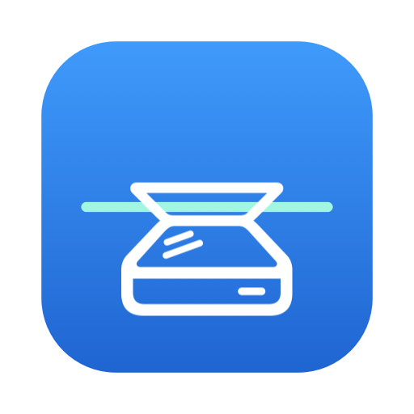
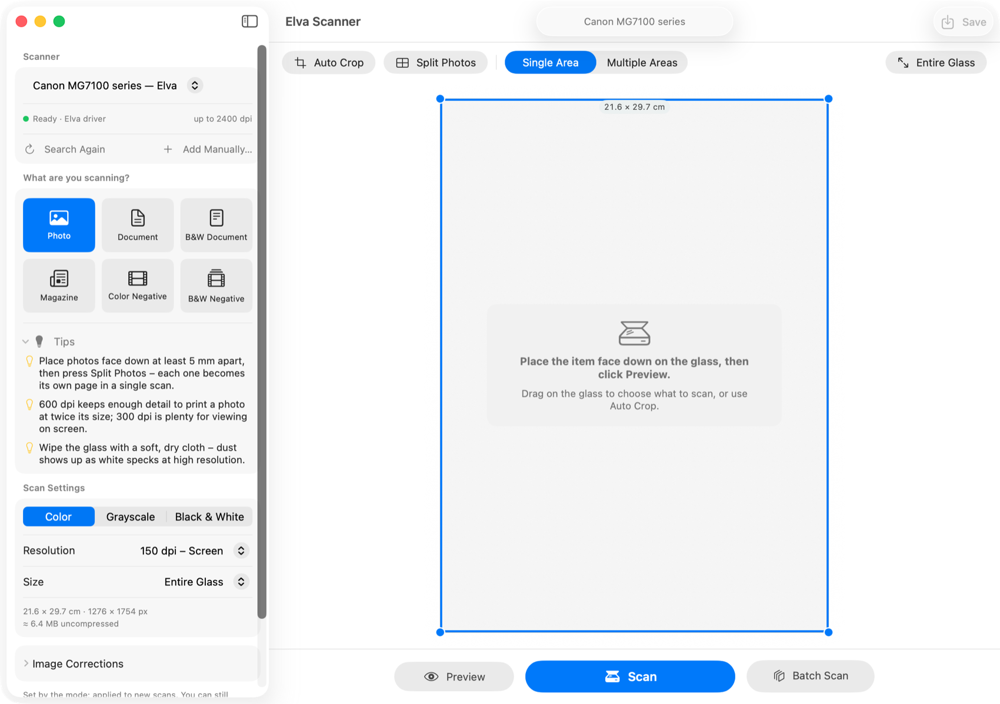
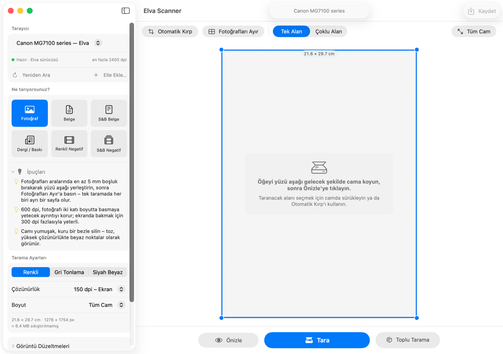

  

<h1 align="center">Elva Scanner for macOS</h1>

  

  Free · Open source · macOS 15 Sequoia and macOS 26 Tahoe · Apple Silicon &amp; Intel
   
  <a href="https://github.com/qokalp/elva-macos-scanner/releases">All versions</a> ·
  <a href="#english">English</a> ·
  <a href="#türkçe">Türkçe</a>

  

---

## English

### Your scanner still works. Your Mac just lost its driver.

Many good printers and scanners were left behind when their makers stopped updating the Mac software.
On a new version of macOS the scanner simply disappears: Image Capture and Preview don't see it,
and the manufacturer's app no longer opens. The hardware is perfectly fine.

**Elva Scanner brings these scanners back.** It talks to the scanner over your Wi-Fi network by
itself, so you don't need the manufacturer's driver. It also works with any scanner your Mac
already supports, so you can use one simple app for everything.

### What you can do

- **Scan over Wi-Fi.** The scanner is found automatically; no cables, no drivers.
- **Pick what you're scanning:** Photo, Document, Black & White Document, Magazine, Color
  Negative or B&W Negative. The right settings and helpful tips are chosen for you.
- **Preview and crop automatically.** Press *Preview* and Elva frames the item on the glass.
- **Scan several photos at once.** Lay a few photos on the glass, press *Split Photos*, and each
  becomes its own picture.
- **Scan multi-page documents.** *Batch Scan* collects page after page; drag the thumbnails to
  put them in order.
- **Fix pictures afterwards:** brightness, contrast, color, sharpness, rotation and auto levels.
  The original scan is never changed.
- **Turn film negatives into photos**, removing the orange tint of color film.
- **Save the way you need:** one PDF (searchable, so you can find and copy text) or TIFF for
  documents; JPEG, HEIC, PNG or TIFF files for photos.
- **English and Turkish.** Follows your Mac's language, or choose it in the app.
- **Private.** Everything stays on your Mac. The only thing the app looks up online is whether a
  new version exists, and you can turn that off.

### Supported scanners

**Tested and working**

| Scanner | Connection |
|---|---|
| Canon PIXMA **MG7100 series** (MG7150, MG7170 and others) | Wi-Fi / Ethernet |

**Expected to work (same Canon technology, not tested yet)**

These Canon models use the same scanning language as the MG7150. They work when the printer is
connected to your network (Wi-Fi or Ethernet). **Models that only have a USB cable aren't supported.**
If you try one, please [tell us how it went](https://github.com/qokalp/elva-macos-scanner/issues/new?template=scanner-report.md).

<b>Canon PIXMA MG series</b> (2010–2017)

MG2100, MG2200, MG2400, MG2500, MG2900, MG3000, MG3100, MG3200, MG3500, MG3600, MG4100, MG4200,
MG5100, MG5200, MG5300, MG5400, MG5500, MG5600, MG5700, MG6100, MG6200, MG6300, MG6400, MG6500,
MG6600, MG6800, MG6900, MG7100 ✅, MG7500, MG7700

<b>Canon PIXMA MX series</b> (office models with fax/feeder)

MX300, MX310, MX320, MX330, MX340, MX350, MX360, MX370, MX390, MX410, MX420, MX430, MX450, MX470,
MX490, MX510, MX520, MX530, MX700, MX710, MX720, MX850, MX860, MX870, MX880, MX890, MX920, MX7600
 <i>Scanning from the glass; the document feeder isn't used yet.</i>

<b>Canon PIXMA MP series</b> (2007–2013, network models)

MP190, MP210, MP220, MP230, MP240, MP250, MP260, MP270, MP280, MP470, MP480, MP490, MP493, MP495,
MP520, MP540, MP550, MP560, MP610, MP620, MP630, MP640

<b>Canon PIXMA TS, TR, G, GX and E series · MAXIFY MB · PIXUS XK</b>

**TS:** TS3100, TS3300, TS3400, TS3500, TS5000, TS5100, TS5300, TS5350i, TS5380, TS5400, TS6000,
TS6100, TS6130, TS6180, TS6200, TS6230, TS6280, TS6300, TS6330, TS6380, TS6400, TS7330, TS7400,
TS7430, TS7450i, TS7530, TS8000, TS8100, TS8130, TS8180, TS8200, TS8230, TS8280, TS8330, TS8380,
TS8430, TS8530, TS8630, TS9000, TS9100, TS9180, TS9500, TS9580 
**TR:** TR4500, TR4600, TR4700, TR7000, TR7500, TR7530, TR7600, TR8500, TR8530, TR8580, TR8600, TR8630, TR9530 
**G / GX / GM:** G600, G2000, G2010, G2020, G2060, G2070, G3000, G3010, G3020, G3060, G3070, G4000,
G4010, G4070, G6000, G6080, G7000, G7080, GX3000, GX4000, GX6000, GX7000, GM4000, GM4080 
**E:** E400, E410, E460, E470, E480, E500, E510, E560, E600, E610, E3100, E3300, E3400, E4200, E4500 
**MAXIFY:** MB2000, MB2100, MB2300, MB2700, MB5000, MB5100, MB5300, MB5400 
**PIXUS:** XK50, XK60, XK70, XK80, XK90, XK100, XK110, XK500

<i>Many of these newer models also support Apple's AirPrint scanning. Elva then shows them twice;
choose the one marked "Elva driver" for the most options.</i>

**HP, Brother, Epson and other brands**

Elva Scanner also works with every scanner your Mac can already use: models with **AirPrint
scanning** (most network printers from about 2014 on) and models whose maker still offers a Mac
driver. A quick check: if the scanner appears in Apple's **Image Capture** app, it appears in Elva too,
with all of Elva's features. Elva can't add support for an older HP or Brother scanner that has
neither AirPrint scanning nor a current Mac driver.

### Install

1. Click the **Download** button above.
2. Open the downloaded **Elva-Scanner.dmg**.
3. Drag **Elva Scanner** onto the **Applications** folder.
4. Open Elva Scanner from Applications or Launchpad.
5. When macOS asks whether Elva Scanner may *find devices on your local network*, click **Allow**.
   Without this the app can't see your scanner.

Make sure the printer is switched on and connected to the same Wi-Fi network as your Mac.

**If macOS says it can't check the app for malicious software** (builds that aren't notarized by
Apple yet): open **System Settings → Privacy & Security**, scroll down and click **Open Anyway**
next to Elva Scanner. You only need to do this once.

### Update

Elva Scanner tells you when a new version is out (you can also choose **Elva Scanner → Check for
Updates…**). Download the new DMG and drag the app into Applications again, replacing the old one.
Your settings are kept.

### Uninstall

Drag **Elva Scanner** from Applications to the Trash.

### Tips

- No scanner listed? Check that the printer is on and on the same network, then press **Search
  Again**. You can also add it by its IP address with **Add Manually…**
- *"The scanner is busy"*: another app or computer is using it. Wait a moment and try again.
- Clean the glass with a soft, dry cloth; dust shows up as white specks.

### Help and feedback

Found a problem, or tried a scanner that isn't on the list?
[Open an issue](https://github.com/qokalp/elva-macos-scanner/issues). Developers: see
[TECHNICAL.md](TECHNICAL.md).

---

## Türkçe

### Tarayıcınız hâlâ çalışıyor. Sadece Mac'iniz sürücüsünü kaybetti.

Pek çok iyi yazıcı ve tarayıcı, üreticileri Mac yazılımlarını güncellemeyi bıraktığında geride
kaldı. Yeni bir macOS sürümünde tarayıcı birden ortadan kayboluyor: Görüntü Yakalama ve Önizleme onu
görmüyor, üreticinin uygulaması artık açılmıyor. Oysa cihazın hiçbir sorunu yok.

**Elva Scanner bu tarayıcıları geri getirir.** Tarayıcıyla Wi-Fi ağınız üzerinden doğrudan konuşur;
üreticinin sürücüsüne ihtiyaç duymaz. Mac'inizin zaten desteklediği tüm tarayıcılarla da çalışır,
böylece her şey için tek ve sade bir uygulama kullanırsınız.

### Neler yapabilirsiniz

- **Wi-Fi üzerinden tarama.** Tarayıcı kendiliğinden bulunur; kablo ya da sürücü gerekmez.
- **Ne taradığınızı seçin:** Fotoğraf, Belge, Siyah-Beyaz Belge, Dergi, Renkli Negatif veya S&B
  Negatif. Uygun ayarlar ve faydalı ipuçları sizin için seçilir.
- **Önizleme ve otomatik kırpma.** *Önizle*'ye basın, Elva camdaki öğeyi kendisi çerçevelesin.
- **Birkaç fotoğrafı tek seferde tarayın.** Fotoğrafları cama dizin, *Fotoğrafları Ayır*'a basın;
  her biri ayrı bir resim olur.
- **Çok sayfalı belgeler.** *Toplu Tarama* sayfaları art arda toplar; sıralamak için küçük resimleri
  sürükleyin.
- **Sonradan düzeltin:** parlaklık, kontrast, renk, keskinlik, döndürme ve otomatik seviyeler.
  Asıl tarama hiçbir zaman bozulmaz.
- **Film negatiflerini fotoğrafa çevirin;** renkli filmin turuncu tonu da giderilir.
- **İhtiyacınıza göre kaydedin:** belgeler için tek PDF (içinde arama yapılabilir, metin
  kopyalanabilir) veya TIFF; fotoğraflar için JPEG, HEIC, PNG veya TIFF.
- **Türkçe ve İngilizce.** Mac'inizin dilini kullanır; isterseniz uygulamadan değiştirebilirsiniz.
- **Gizlilik.** Her şey Mac'inizde kalır. Uygulamanın internette baktığı tek şey yeni sürüm olup
  olmadığıdır; bunu da kapatabilirsiniz.

### Desteklenen tarayıcılar

**Test edildi, çalışıyor**

| Tarayıcı | Bağlantı |
|---|---|
| Canon PIXMA **MG7100 serisi** (MG7150, MG7170 ve diğerleri) | Wi-Fi / Ethernet |

**Çalışması beklenenler (aynı Canon teknolojisi, henüz test edilmedi)**

Bu Canon modelleri MG7150 ile aynı tarama dilini kullanır. Yazıcı ağınıza (Wi-Fi veya Ethernet)
bağlıysa çalışırlar. **Yalnızca USB kablosu olan modeller desteklenmez.** Birini denerseniz lütfen
[sonucu bize bildirin](https://github.com/qokalp/elva-macos-scanner/issues/new?template=scanner-report.md).
Tam model listesi yukarıdaki İngilizce bölümde: **PIXMA MG, MX, MP, TS, TR, G, GX, E** serileri,
**MAXIFY MB** ve **PIXUS XK** (toplam ~190 model).

**HP, Brother, Epson ve diğer markalar**

Elva Scanner, Mac'inizin zaten kullanabildiği tüm tarayıcılarla da çalışır: **AirPrint ile tarama**
destekleyen modeller (yaklaşık 2014 sonrası ağ yazıcılarının çoğu) ve üreticisinin hâlâ Mac sürücüsü
sunduğu modeller. Kısa bir kontrol: tarayıcı Apple'ın **Görüntü Yakalama** uygulamasında görünüyorsa
Elva'da da tüm özellikleriyle görünür. AirPrint taraması ve güncel Mac sürücüsü olmayan eski bir HP
veya Brother tarayıcıya Elva destek ekleyemez.

### Kurulum

1. Yukarıdaki **Download** düğmesine tıklayın.
2. İnen **Elva-Scanner.dmg** dosyasını açın.
3. **Elva Scanner**'ı **Uygulamalar** (Applications) klasörüne sürükleyin.
4. Elva Scanner'ı Uygulamalar klasöründen veya Launchpad'den açın.
5. macOS, Elva Scanner'ın *yerel ağdaki aygıtları bulmasına* izin verip vermeyeceğinizi sorduğunda
   **İzin Ver**'e tıklayın. Bu izin olmadan uygulama tarayıcınızı göremez.

Yazıcının açık ve Mac'inizle aynı Wi-Fi ağına bağlı olduğundan emin olun.

**macOS uygulamayı kötü amaçlı yazılım için denetleyemediğini söylerse** (Apple noter onayı henüz
almamış sürümler): **Sistem Ayarları → Gizlilik ve Güvenlik**'i açın, aşağı kaydırıp Elva Scanner'ın
yanındaki **Yine de Aç**'a tıklayın. Bunu yalnızca bir kez yapmanız yeterli.

### Güncelleme

Yeni sürüm çıktığında Elva Scanner size haber verir (**Elva Scanner → Güncellemeleri Denetle…**
menüsünü de kullanabilirsiniz). Yeni DMG'yi indirin ve uygulamayı yeniden Uygulamalar klasörüne
sürükleyip eskisinin yerine koyun. Ayarlarınız korunur.

### Kaldırma

**Elva Scanner**'ı Uygulamalar klasöründen Çöp Sepeti'ne sürükleyin.

### İpuçları

- Tarayıcı listede yok mu? Yazıcının açık ve aynı ağda olduğunu kontrol edip **Yeniden Ara**'ya
  basın. **Elle Ekle…** ile IP adresinden de ekleyebilirsiniz.
- *"Tarayıcı meşgul"*: başka bir uygulama veya bilgisayar kullanıyordur. Biraz bekleyip yeniden deneyin.
- Camı yumuşak, kuru bir bezle silin; toz beyaz noktalar olarak görünür.

### Yardım ve geri bildirim

Bir sorun mu buldunuz ya da listede olmayan bir tarayıcı mı denediniz?
[Bir kayıt açın](https://github.com/qokalp/elva-macos-scanner/issues). Geliştiriciler için:
[TECHNICAL.md](TECHNICAL.md).

  

---

  MIT License · © 2026 Gökalp Köseoğlu 
  Canon, PIXMA, MAXIFY, HP, Brother, Epson and AirPrint are trademarks of their respective owners.
  Elva Scanner is an independent project and is not affiliated with or endorsed by them.

